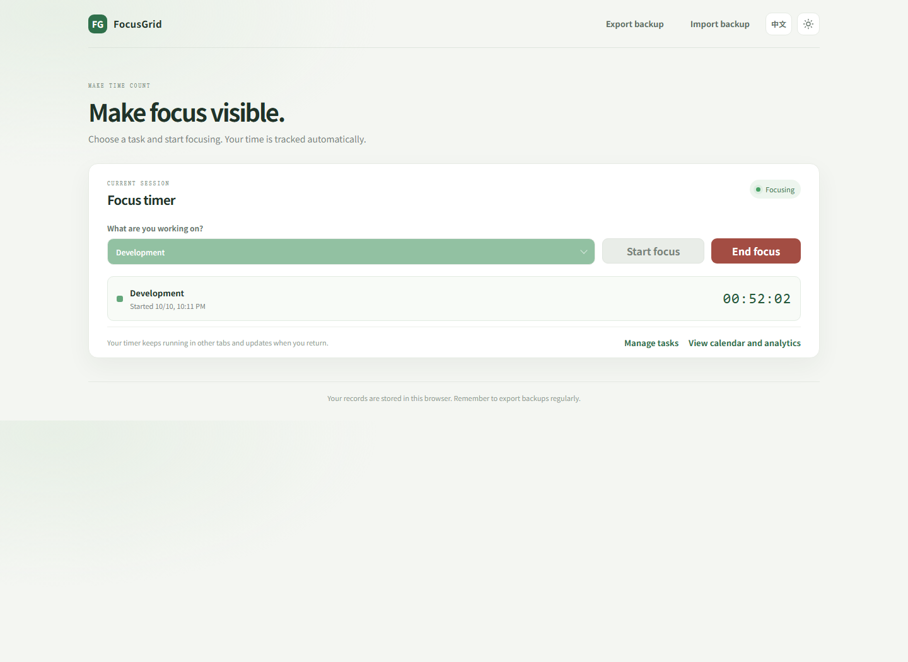
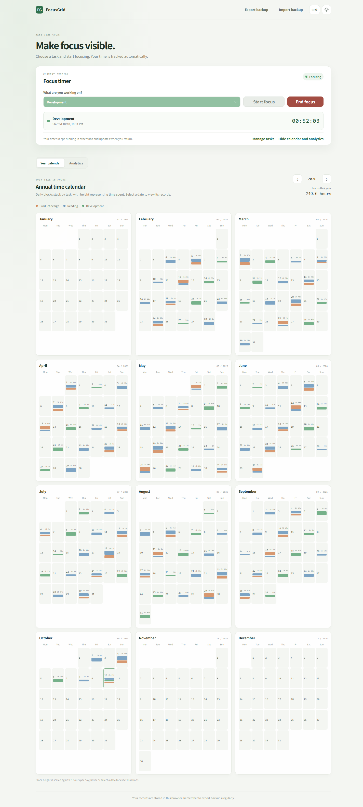
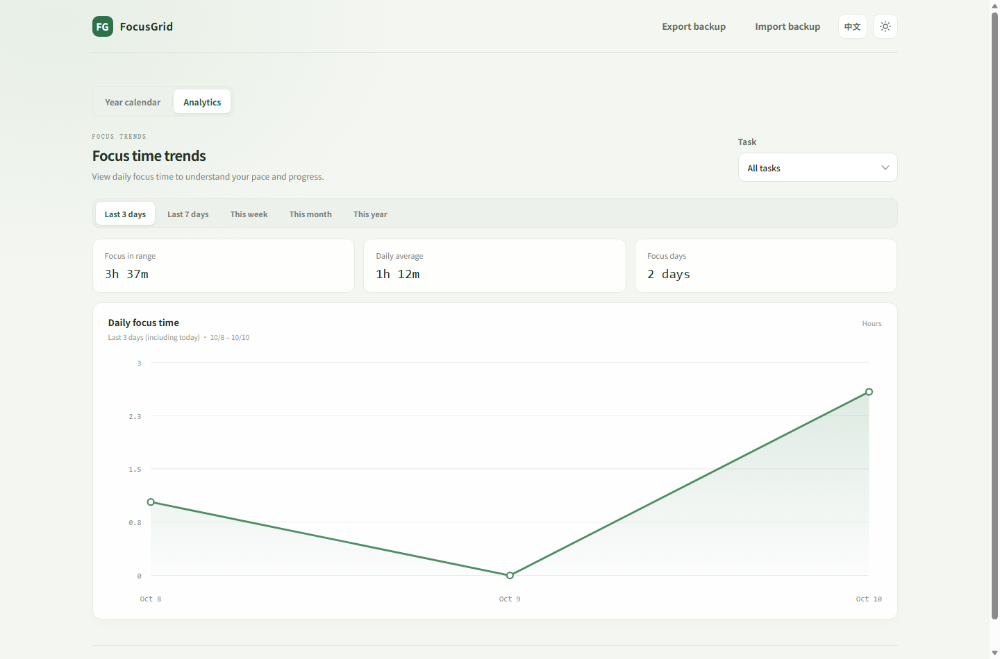

# 专注刻度 FocusGrid

专注刻度是一款轻量、离线优先的个人专注时间记录网页。选择工作项后开始计时，结束时保存专注时长；你可以用日历查看每天在不同工作项上的投入，也可以按时间范围分析专注趋势。

> **AIGC 生成声明：本项目完全由人工智能生成（AIGC），仅供学习和交流使用。** 使用前请自行检查代码是否符合你的需求。软件按“现状”提供，不附带任何保证。

## 功能

- 创建、编辑和删除工作项，并为每项设置颜色。
- 专注计时在浏览器切到后台时继续；刷新或重新打开页面后，可以继续处理尚未结束的计时。
- 结束计时前可修正起止时间，也可以继续计时或直接取消本次记录。
- 查看年度日历：每天的工作项色块按时长堆叠。
- 按过去 3 天、过去 7 天、本周、本月或本年查看折线趋势，并筛选单个工作项。
- 在中文和英文界面间切换，并选择浅色或深色主题。
- 将数据导出为 JSON 备份，也可从备份导入恢复。

## 界面预览

以下截图使用虚构的演示数据生成，不包含个人记录。

### 专注计时

### 年度日历

### 数据分析

## 使用方法

无需安装依赖或构建步骤：

1. 下载或克隆本仓库。
2. 用现代浏览器打开 `index.html`。
3. 添加工作项，选择当前任务，然后点击“开始专注”。
4. 如需查看日历和分析，在计时卡片下方展开对应视图。

建议定期使用“导出备份”保存数据副本。

## 数据与隐私

- 工作项、专注记录、主题和语言偏好保存在当前浏览器的本地存储中。
- 项目不提供账号、服务器同步或云端备份。清理浏览器网站数据可能导致记录丢失。
- JSON 备份包含专注记录和工作项数据；请妥善保管导出的文件。
- 关闭页面期间，未结束的专注仍按开始与结束时间戳计算；重新打开后可继续处理或修正。

## 许可证

本仓库采用 [0BSD](./LICENSE) 许可证，允许在不附加署名要求的情况下使用、复制、修改和分发，且不限制商业用途。软件不提供任何保证。请同时注意：AIGC 生成内容在不同司法辖区的著作权认定可能不同，许可证表达的是本项目的许可意图，不构成法律意见。

英文版本见 [README_EN.md](./README_EN.md)。
